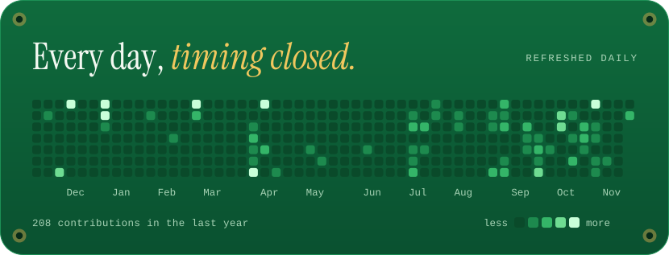
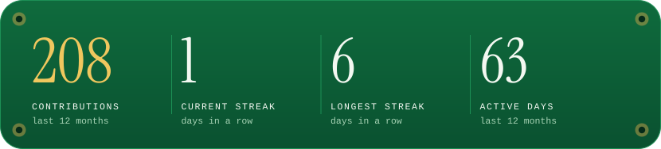
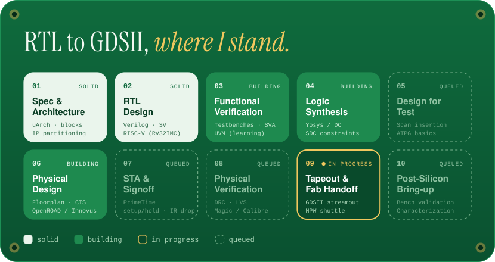
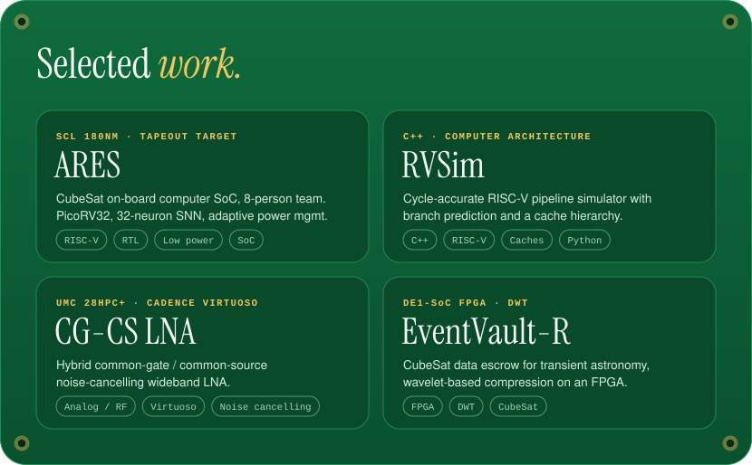

### `omie@silicon ~ $ ./contributions.sh`

### `omie@silicon ~ $ ./flow.sh`

<b>The roadmap behind it</b> (what I'm working through, in order)

- [x] RTL fluency in Verilog / SystemVerilog
- [x] RISC-V core-level understanding, SoC architecture and integration
- [ ] Structured verification: testbenches to UVM-style environments
- [ ] Take one block through an industry-grade P&R tool end to end
- [ ] Close real STA signoff on a block, not just synthesis-stage timing
- [ ] Run a design through DFT / ATPG at least once
- [ ] Understand PDK mechanics beyond 180 nm (advanced nodes)
- [ ] Land an internship inside an ASIC design or verification team

### `omie@silicon ~ $ ./projects.sh`

### `omie@silicon ~ $ ./links.sh`

**VLSI design · RTL · physical design · verification**

<!-- add more, e.g.:

-->
